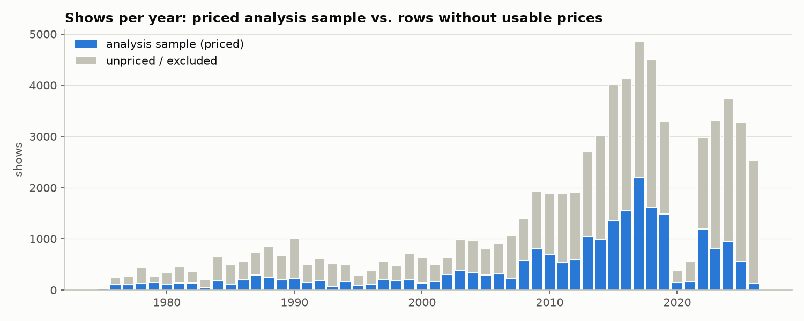
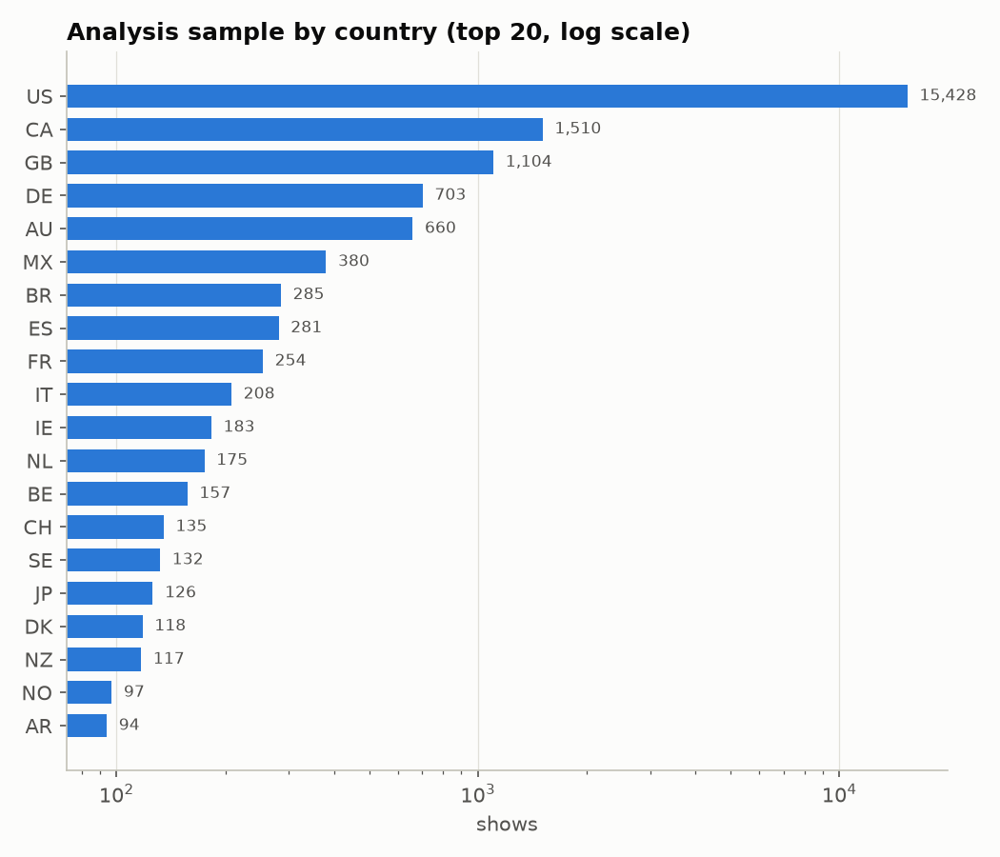
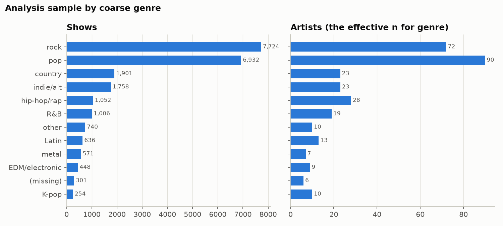
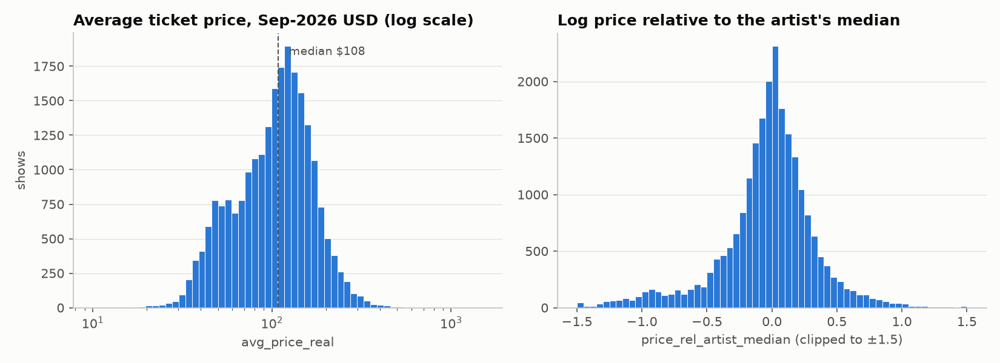
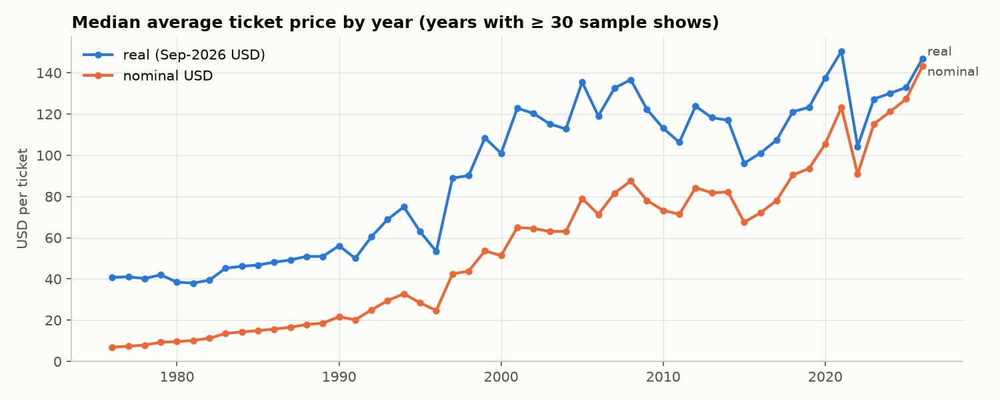
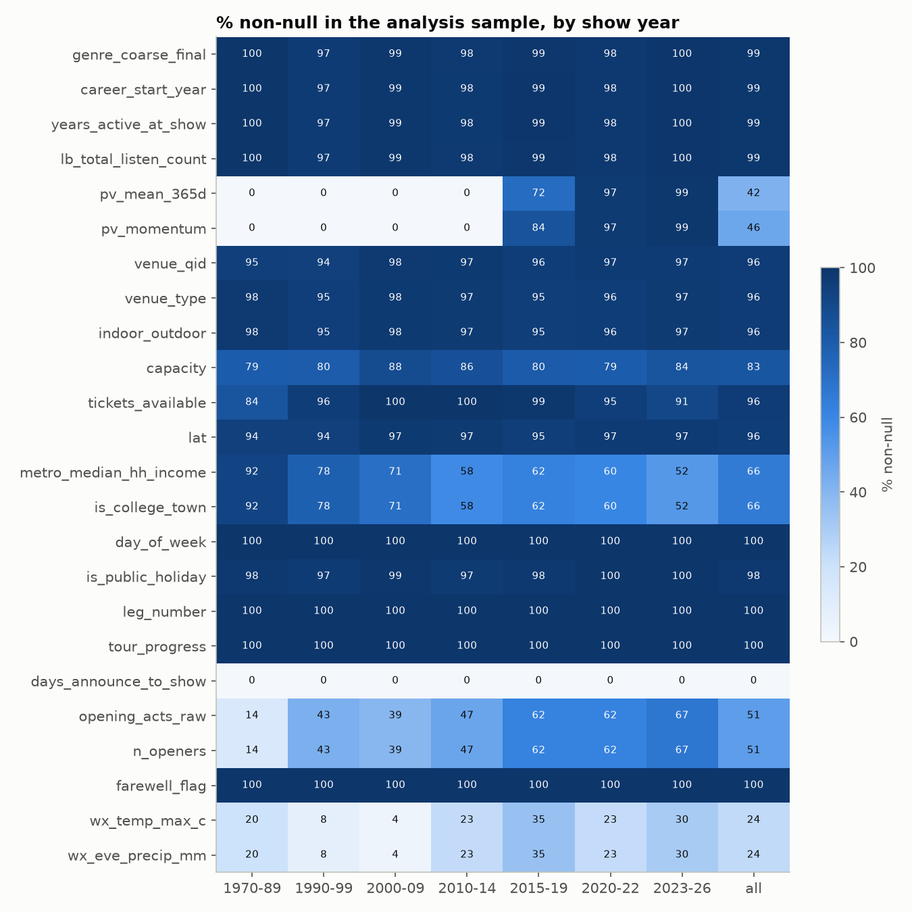
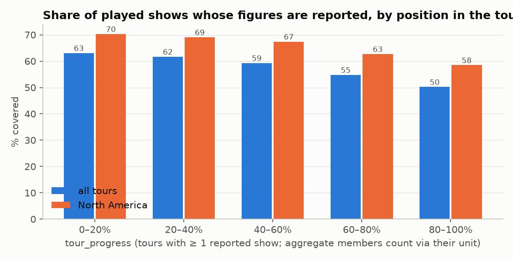

# Data quality report: data/shows.parquet

Generated by `src/analysis/data_quality.py` from the build at 2026-10-20T04:35+00:00. Rerun after `build_shows.py`; every number below is recomputed.

**Bottom line.** 71,285 show rows, of which 24,078 have a price. The **analysis sample is 23,323 rows from 310 artists** (761 tour articles). The sample is big-tour, mostly North American (US 66%), and concentrated in 2008–2019 plus 2022–2025. Prices are clean once the 49 flagged rows are removed (no CPI gaps, no duplicate keys). The biggest risks are **selection** (which shows have figures), **"$" read as USD** at non-US shows, and **features that are ex post or current snapshots**.

## 1. Join coverage

| table | status | rows | % shows matched | % priced filled | % sample filled |
|---|---|---|---|---|---|
| artist | ok | 482 | 100.0 | 100.0 | 100.0 |
| artist_show | ok | 71285 | 100.0 | 100.0 | 100.0 |
| venue | partial | 13048 | 100.0 | 96.4 | 96.4 |
| metro | ok | 13048 | 100.0 | 100.0 | 100.0 |
| venue_metro | ok | 13048 | 100.0 | 100.0 | 100.0 |
| calendar | ok | 71285 | 100.0 | 100.0 | 100.0 |
| tour_context | ok | 71285 | 100.0 | 100.0 | 100.0 |
| bill | partial | 71285 | 100.0 | 0.0 | 0.0 |
| weather | partial | 71285 | 100.0 | 23.2 | 23.6 |

"filled" means processed (venue resolved on Wikidata; weather `ok`; bill: opener pageview **and** Wikidata/album lookups done, while its flags are usable regardless). Missing or partial tables give nulls, recorded as `has_<table>` in shows.parquet. **The bill table is partial**, the venue table is partial (96.4% of the sample resolved), and weather is partial (23.6% of the sample `ok`).

Exclusions from the priced rows: non_performer 510, dup_boxoffice 76, dup_figure_copy 68, aggregate_multi_venue 52, tour_outlier 35, implausible 14. Every priced row is in USD (the 33 non-USD grosses have no `gross_usd`, and there's no local FX table to convert them).

## 2. Coverage by year, country, genre

The priced sample is thin before 2008 (< 600 shows a year), collapses in 2020–21 (COVID), and drops off in 2025–26 because the latest tours haven't reported or been written up yet. 493 sample shows are from the 1970s; they're deflated with the pre-1980 BLS CPI from the raw file.

Genre is missing for 1.3% of sample rows (6 artists). Pop and rock make up 63% of rows. EDM, K-pop, metal and Latin each have ≤ 13 artists, so any genre contrast rests on a handful of acts.

## 3. Price distribution

- Real average price: median $108, p5 $42, p95 $213, max $1,248 (Sep-2026 USD). The log price is roughly symmetric, with SD 0.50.
- **Variance decomposition** of the log real price: SD 0.50 overall, 0.37 after removing the artist median, and 0.22 within a tour. Most variation is between artists and tours. Within-tour (city, date, venue) effects have to show up in roughly a ±0.2 log-point band.
- Real prices roughly tripled from the 1980s to the 2020s (chart). Year effects or time trends are mandatory in any model.

## 4. Missingness

Patterns to plan around:
- **Pageview features (`pv_*`) are structurally missing before mid-2015**, so popularity and momentum hypotheses are tested only on 2016+ shows (10,794 rows).
- **`days_announce_to_show` is ~empty** (0.0% non-null). There's no lead-time feature.
- **Metro (Census) features are US-only** (66% of the sample). `is_college_town` is True on only 118 sample rows.
- **Venue Wikidata fields** (type, capacity, coordinates) are missing for the 3.6% of sample shows whose venues haven't been resolved yet, plus venues with no item.
- **Weather** is `ok` for 5,506 sample rows (24%). The rest are pending (rerun) or have no coordinates (non-US venues without a Wikidata point).
- **Bill:** `n_openers` is known for 51% of the sample (a blank opener cell means unknown). Opener and album pageviews are nearly empty (see section 8).

## 5. Duplicates

- `show_id` is unique (71,285 ids; 18 carry a `__2`/`__3` collision suffix), and every feature table is unique on its key. The join is validated many-to-one and never changes the row count (tests/test_shows_join.py).
- **Duplicate box office lines** (review 1, items 2–3): 58 groups (116 rows) where two priced rows on the same date carry an identical gross, or identical tickets (> 1,000) with gross within 5%. Venue names are deliberately not compared ("Superdome" vs "Louisiana Superdome"). Cross-artist groups come from an opener's or co-headliner's article quoting the headliner's line. Within-artist groups are the same Rush show listed twice under venue variants. Every group is resolved by hand in `data/manual/boxoffice_dedupe.csv`, with a reason per row: 40 rows kept, 76 dropped. The headliner is kept only when its opening-act cell names the other act. Co-bills with no identifiable headliner (Chesney/Aldean 2015, Journey/Santana 1982, …) and festival totals (Foo Fighters/Marilyn Manson, Rock im Ring 2015) are dropped entirely. The Smashing Pumpkins/Marilyn Manson End Times dates are kept under the co-headline act key. `dup_unreviewed` is zero (tested).
- **Copied figures:** 68 priced rows share an artist's exact gross and tickets with a different date (e.g. Metallica Brisbane 2025 = Bologna 2026; Scorpions Hamburg March = November 2016). Which date the figure belongs to can't be told, so all copies are excluded (`dup_figure_copy`).
- **One performer, several artist_ids** (review 1, item 4): artist_id is per act as written. `split_key` is the connected component of artist_ids linked by a shared QID or headliner wikilink, a Wikidata P527/P463/P361 edge between two artists in the data (band ↔ member, duo ↔ partner; organisations can't chain because both ends must be artists here), or a manual relation (`data/manual/artist_relations.csv`: NSYNC/Timberlake, Queen/Queen + Adam Lambert and + Paul Rodgers, Jonas Brothers/Demi & Nick, Selena Gomez/the Scene, the Eagles alias). In the sample, 38 performer groups span more than one artist_id (7,837 rows); the largest has 11 ids. Every pair the skeptic listed now shares a split (tested). `artist_key` inherits the QID through the headliner wikilink (`the-eagles` → Eagles). Non-performer acts (Cirque du Soleil, American Idol, Glee and High School Musical casts, Various Artists, the Honda Civic Tour) are excluded: 510 priced rows.
- **Same artist, date and city at two venues:** 51 rows, almost all unpriced (promo appearances, festival side stages). They're left in.
- **Multi-night aggregates:** 32,046 rows sit in 8,970 aggregate groups. They're treated as one unit each (DATA_DICTIONARY.md, Join decisions), and deflated at the midpoint month of their span. 846 member rows couldn't be placed in a group from row order; they carry no figures. 52 priced aggregates span several venues (leg totals) and are excluded. **Priced units with fewer placed members than aggregate_n_shows** (review 1, item 10; agg_n_venues may undercount for these):

| show_id | aggregate_n_shows | agg_n_venues | agg_span_days | analysis_sample | placed |
|---|---|---|---|---|---|
| aerosmith__1988-09-14__pacific-amphitheatre | 3 | 1 | 1 | True | 2 |
| anita-baker__1990-12-04__valley-forge-music-fair | 4 | 1 | 3 | True | 3 |
| drake-and-migos__2018-11-16__state-farm-arena | 3 | 1 | 1 | True | 2 |
| linkin-park__2014-05-30__parque-da-bela-vista | 10 | 9 | 15 | False | 9 |
| linkin-park__2014-10-18__outside-of-mineirao | 3 | 2 | 1 | False | 2 |
| linkin-park__2014-11-03__hallenstadion | 17 | 15 | 21 | False | 16 |
| linkin-park__2015-05-09__mgm-resorts-international | 10 | 9 | 52 | False | 9 |
| linkin-park__2015-07-17__nanjing-olympic-sports-centre | 6 | 5 | 9 | False | 5 |
| linkin-park__2015-08-20__kempische-steenweg | 11 | 10 | 17 | False | 10 |
| phish-concert-tours-and-festivals__1998-08-02__deer-creek-music-center | 2 | 1 | 0 | True | 1 |
| phish-concert-tours-and-festivals__1998-08-15__loring-air-force-base | 2 | 1 | 0 | True | 1 |
| phish-concert-tours-and-festivals__1998-12-28__madison-square-garden | 4 | 1 | 0 | True | 1 |
| run-the-jewels__2017-02-25__terminal-5 | 4 | 1 | 2 | True | 3 |

## 6. Outliers

- The collector's flags remove 14 `implausible` rows (< $5 or > $2,000) and 35 `tour_outlier` rows (> 4× or < 0.25× the tour median).
- 455 sample rows sit more than 3× (log 1.1) away from their artist's median. They are kept. The extremes checked by hand look genuine rather than parse errors (Barbra Streisand's Las Vegas and arena dates, McCartney at the Budokan, the Rolling Stones in a 6,700-seat casino, U2's $5 1987 show). The middle of the tail hasn't been audited row by row, so robust losses or a winsorized target are worth a sensitivity check. Top of the real-price distribution:

| show_id | avg_price_usd | avg_price_real | tickets_sold | aggregate_n_shows |
|---|---|---|---|---|
| barbra-streisand__1993-12-31__mgm-grand-garden-arena | 539.8 | 1,247.6 | 25,120.0 | 2 |
| the-rolling-stones__2021-11-23__hard-rock-live | 792.6 | 960.8 | 6,725.0 | 1 |
| barbra-streisand__2006-11-18__mgm-grand-garden-arena | 504.7 | 843.9 | 15,317.0 | 1 |
| paul-mccartney__2015-04-28__nippon-budokan | 581.3 | 827.8 | 11,833.0 | 1 |
| barbra-streisand__2007-07-18__the-o2-arena | 492.3 | 796.4 | 41,045.0 | 3 |
| barbra-streisand__2006-11-04__boardwalk-hall | 440.2 | 736.0 | 12,639.0 | 1 |
| lali__2014-04-19__teatro-opera-allianz | 500.0 | 710.6 | 5,000.0 | 2 |
| paul-mccartney__2017-04-25__nippon-budokan | 485.8 | 669.5 | 11,296.0 | 1 |

Bottom:

| show_id | avg_price_usd | avg_price_real | tickets_sold |
|---|---|---|---|
| u2__1987-12-19__sun-devil-stadium | 5.0 | 14.6 | 110,450.0 |
| justin-bieber__2010-08-05__bankatlantic-center | 10.1 | 15.5 | 14,104.0 |
| marilyn-manson__1995-02-10__pearl-street-nightclub | 7.1 | 16.0 | 373.0 |
| justin-bieber__2011-10-05__estadio-olimpico-joao-havelange | 11.2 | 16.6 | 46,533.0 |
| bon-jovi__1987-01-19__national-orange-showgrounds | 5.5 | 16.8 | 6,500.0 |

- 2 sample rows have tickets_sold > tickets_available (by more than 5%), and 25 have fewer than 500 tickets per show. They're left in; their average prices aren't extreme.
- **Currency ("$" assumed USD).** 7,870 sample rows are non-US shows with a USD gross. `country_final` fills the country for rows whose spine country is null (venue Wikidata country, doubled spine text, the city suffix, or a US Census match), so these are now flagged too. Median price relative to the artist's 5-year era, by country (n ≥ 100):

| country | n | median log price vs artist × 5-yr era |
|---|---|---|
| NL | 175 | -0.188 |
| BE | 157 | -0.168 |
| IT | 208 | -0.151 |
| MX | 380 | -0.132 |
| SE | 132 | -0.116 |
| FR | 254 | -0.100 |
| BR | 285 | -0.089 |
| ES | 281 | -0.081 |
| DE | 703 | -0.074 |
| IE | 183 | -0.016 |
| GB | 1104 | -0.012 |
| CA | 1510 | -0.006 |
| US | 15428 | 0.005 |
| DK | 118 | 0.039 |
| NZ | 117 | 0.062 |
| CH | 135 | 0.146 |
| AU | 660 | 0.173 |
| JP | 126 | 0.264 |

  These medians can't separate a country premium from currency mislabeling. The formal test is the within-tour FX-slope regression (skeptic's spec) in `src/analysis/currency_test.py` → reports/currency_test.md. Country and city premia are reported only alongside it.
- Non-pricing anomalies: some "artists" are page titles rather than acts (Phish concert tours and festivals (279), List of 2023 AJR festival shows (8), List of Lady Gaga live performances (2), List of Britney Spears live performances (1), List of Christina Aguilera concerts (1)). `artist_key` strips the "List of ..." wording and maps them to the performer where possible. "Phish concert tours and festivals" has no QID and stays its own key.

## 7. Selection bias

- **Which tours:** only tours big enough to report to Billboard Boxscore/Pollstar *and* to have a Wikipedia box office table. These are arena and stadium acts with long careers; the top 10 artists supply 19% of the sample rows. Results describe superstar pricing, not the concert market. Effects that matter for mid-size acts (opener draw, college towns, club tours) are the least identifiable.
- **Which shows within a tour** (review 1, item 6; `src/analysis/selection.py`): "covered" counts members of priced aggregates through their unit. Among 54,458 played shows in 947 tours with at least one reported show, 58% are covered (44% if aggregate members were counted as unpriced). Coverage falls from 63% in the first fifth of a tour to 50% in the last fifth, and from 70% to 58% in North America alone. By continent: north_america 66%, oceania 56%, latin_america 52%, europe 41%, mea 38%, asia 34%. By Wikidata capacity (resolved venues only, 69% of the universe; resolution itself ran priced-first): <3k 44%, 3k–8k 61%, 8k–25k 70%, 25k+ 78%.
- **Within-tour LPM** of covered (tour FE, clustered by split_key, n = 54,441, G = 244): tour progress -0.115 (0.017), log metro population +0.024 (0.005), log Wikidata capacity +0.023 (0.009), Fri/Sat -0.005 (0.004), Sunday -0.014 (0.005), Europe -0.183, Asia -0.203. **Supported:** selection is on price-relevant observables (position in the tour, metro size, venue size, region). Weekday barely matters.
- **Is selection on price itself?** The earlier claim that "priced shows skew toward strong nights" was never tested and is withdrawn. Among North American reported shows (year FE), tours with higher coverage have higher sell-out (+0.079 per unit of coverage, SE 0.014). They also price slightly higher relative to the same artist's era (+0.043, SE 0.016). So better-documented tours are somewhat stronger tours, a tour-level selection that within-tour comparisons absorb and between-tour comparisons do not.
- **Mitigations used in task 6:** tour/artist FE; inverse-probability weights from the LPM (`data/selection_weights.parquet`, p clipped at 0.05, weights trimmed at the 99th percentile); a sensitivity spec on tours with coverage ≥ 0.8 (12,704 sample shows); results by era. No Heckman correction (no credible exclusion restriction).
- **When:** coverage before 2008 is sparse and older articles are edited less. Era-specific results should be read as "among documented tours".

## 8. Can the data test each hypothesis?

Power is assessed on the analysis sample, in log points (0.05 ≈ 5%), at 80% power and α = 0.05. Binary variables use only the groups (tours or artists, per the FE named) where the variable varies. Continuous variables are scaled to a 1-SD within-group change.
- **naive MDE** = 2.8 × within-group residual SD × √(1/n₁ + 1/n₀) (binary), or 2.8 × SD / √n (continuous). It treats shows as independent, so it is far too optimistic.
- **clustered MDE** = 2.8 × the cluster-robust SE (clustered by performer group, `split_key`) of the fixed-effects slope, computed on the real data. **The coefficient itself is deliberately not computed or reported here** (that's task 6). This is the planning number. Genre uses artist medians: 2.8 × SD(artist median) × √(2/artists in a median-sized genre).

The real power driver is the number of tours or artists with variation, not n.

| hypothesis | variable | status | n | n (within-group variation) | performer groups w/ variation | FE groups w/ variation | G (clusters) | naive MDE | clustered MDE | notes |
|---|---|---|---|---|---|---|---|---|---|---|
| City premium (artist FE) | metro_key dummies; US: metro_median_hh_income | TESTABLE | 15305 | 15298 | 204 | 267 | 204 | 0.008 | 0.008 | 265 artists play ≥ 5 metros; 146 metros have ≥ 30 shows from ≥ 5 artists. **This row assesses only the income slope**, per 1 SD of within-artist income (US only, SNAPSHOT 2024 ACS); the metro-dispersion test is in task 6 |
| Weekend premium | is_fri_sat (tour FE, single-night units) | TESTABLE | 19060 | 18829 | 211 | 739 | 211 | 0.009 | 0.013 | aggregates excluded because their date is the first night only |
| Holiday premium | is_holiday_eve or is_long_weekend (tour FE) | TESTABLE | 19060 | 15194 | 169 | 460 | 169 | 0.018 | 0.020 | few holiday shows per tour; national calendars only |
| Venue size | log tickets_available_per_show (artist FE) | TESTABLE | 22479 | 22474 | 220 | 286 | 220 | 0.007 | 0.024 | capacity as sold is partly an OUTCOME; Wikidata `capacity` is a current SNAPSHOT |
| Fanbase vs capacity | log(pv_mean_365d) − log capacity (artist FE) | TESTABLE (2016+) | 9472 | 9461 | 158 | 185 | 158 | 0.007 | 0.038 | pageviews exist only from mid-2015; LB listeners are a current snapshot (between-artist only) |
| Popularity level | log pv_mean_365d (artist FE, i.e. over time) | TESTABLE (2016+) | 9809 | 9794 | 165 | 193 | 165 | 0.007 | 0.031 | POST_ONSALE window; re-anchor if on-sale dates appear |
| Momentum (Dom Dolla effect) | pv_momentum (artist FE) | TESTABLE (2016+), noisy | 10794 | 10779 | 175 | 209 | 175 | 0.007 | 0.020 | Wikipedia attention ≠ fandom; the 30-day window is mostly after on-sale (reverse causality risk) |
| Genre / experience premium | genre_coarse_final (between artists) | WEAK (between-artist) | 23022 | — | 304 | 11 | 304 | — | 0.419 | genre is fixed per artist, so n = artists (7–90 per genre). MDE is for a median-sized genre vs. one other; no direct 'experience/production' measure |
| Bill size (openers) | n_openers (tour FE) | TESTABLE | 11819 | 8759 | 99 | 209 | 99 | 0.007 | 0.024 | known for 11,819 rows (blank cell = unknown); multi_artist_flag is True on 100% of known rows, so it has almost no within-tour variation |
| Co-headline | co_headliner_flag (performer-group FE: solo vs. package tours) | WEAK (< 30 groups with variation) | 23323 | 5433 | 23 | 23 | 23 | 0.036 | 0.176 | 1,397 co-headlined rows; identified from performers who also tour solo; G < 30: use t(G−1) and a wild cluster bootstrap in task 6 |
| Opener draw | log opener_pv_mean_90d_max (tour FE) | WEAK (< 30 groups with variation) | 259 | 237 | 28 | 34 | 28 | 0.021 | 0.023 | opener pageviews filled on only 259 sample rows (2016+ and linked openers only); G < 30: use t(G−1) and a wild cluster bootstrap in task 6 |
| Tour leg | leg_number > 1 (tour FE) | TESTABLE | 23323 | 15863 | 162 | 433 | 162 | 0.010 | 0.043 | legs are inferred for 55% of sample rows (gap/continent rule); EXPOST |
| Farewell tour | farewell_flag (artist FE) | UNDERPOWERED (< 10 groups with variation) | 23323 | 1227 | 7 | 7 | 7 | 0.069 | 0.206 | 17 farewell tours in the sample; tour-level label, hindsight categories; identification needs the same artist's other tours; G < 30: use t(G−1) and a wild cluster bootstrap in task 6 |
| Reunion tour | reunion_flag (artist FE) | WEAK (< 30 groups with variation) | 23323 | 1718 | 10 | 10 | 10 | 0.075 | 0.178 | 17 reunion tours in the sample; tour-level label, hindsight categories; identification needs the same artist's other tours; G < 30: use t(G−1) and a wild cluster bootstrap in task 6 |
| Added dates / multi-night demand | aggregate_n_shows > 1 (tour FE) | TESTABLE (as multi-night demand) | 23323 | 19716 | 172 | 570 | 172 | 0.011 | 0.021 | is_added_date_proxy is True on only 52 sample rows, because the 2nd+ nights of a stand usually sit inside an aggregate (unpriced). Can't separate 'added' from 'announced up front'; EXPOST |
| Outdoor premium | indoor_outdoor (artist FE) | TESTABLE | 22496 | 22052 | 200 | 247 | 200 | 0.015 | 0.031 | class-based; domed stadiums typed only as 'stadium' are misread as outdoor |
| Weather (outdoor) | wx_eve_precip_mm ≥ 1 at outdoor venues (tour FE) | WEAK / partial | 1459 | 880 | 60 | 97 | 60 | 0.044 | 0.042 | weather ok on 5,506 sample rows; 1,459 outdoor; 186 rainy outdoor evenings. Prices are set before the weather is known, so the expected effect on avg price is small (SHOWDAY) |
| Set-list popularity | — | NOT TESTABLE | 0 | — | — | — | — | — | — | setlist.fm needs permission. Proxy: album attention `album_pv_*` (bill table), filled on 0 sample rows; it measures the album, not the set |

## 9. Readiness for task 6

- **Ready now:** the targets (`log_avg_price_real`, `price_rel_artist_median`), the artist split, and the city-premium, weekend, venue-size, tour-leg, multi-night, and popularity/momentum (2016+) analyses. Calendar, tour context, metro, and artist features cover 94–100% of the sample.
- **Waiting on the venue table** (currently 96.4% of the sample resolved): `venue_type`, `indoor_outdoor` and Wikidata `capacity` for the remaining venues. Venue-size work can start on `tickets_available_per_show` (96% coverage), with Wikidata capacity added when the table completes.
- **Bill table landed** (partial; 0.0% of sample rows have both opener pageviews and Wikidata lookups done): bill size, co-headline, festival and farewell/reunion flags are usable now. **Still thin:** opener pageviews (259 sample rows) and album pageviews (0 rows), so opener draw and the set-list proxy are underpowered unless those columns fill.
- **Waiting on weather** (23.6% of the sample `ok`): the outdoor × weather interaction. Low power is expected even when complete.
- **Not testable:** set-list popularity (setlist.fm permission). Purchase-time prediction is not testable either, because there are no on-sale dates and EXPOST/POST_ONSALE features would leak.
