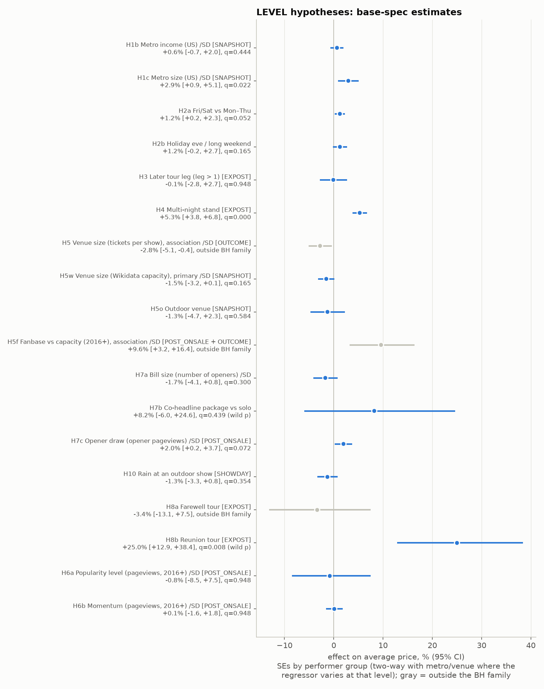
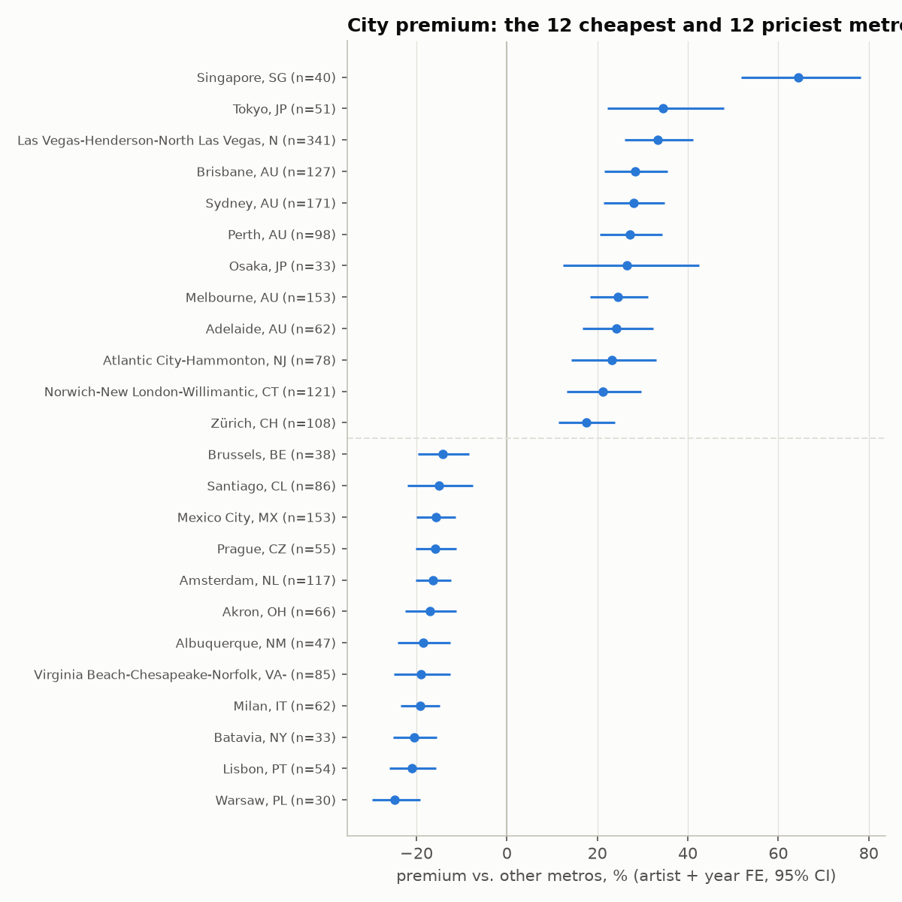
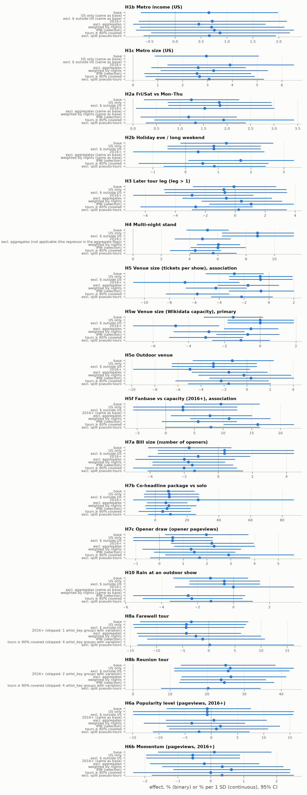
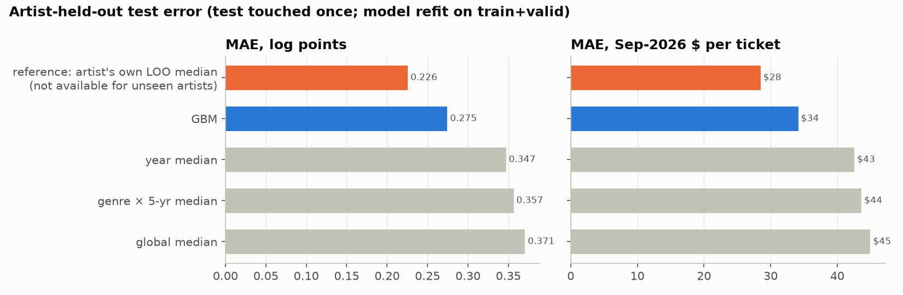
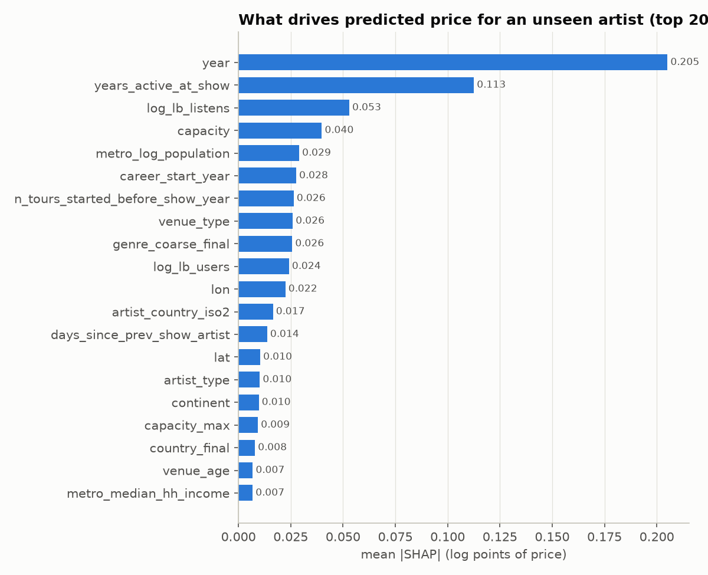
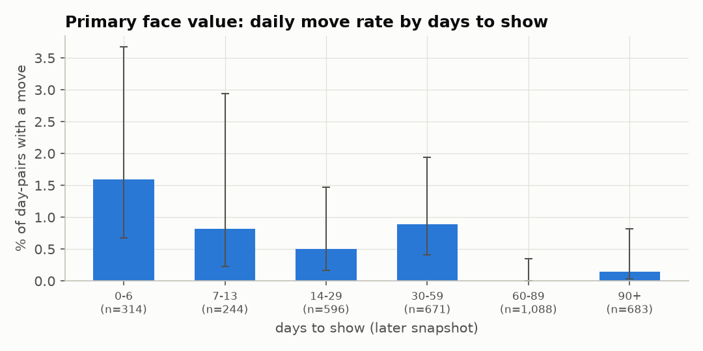
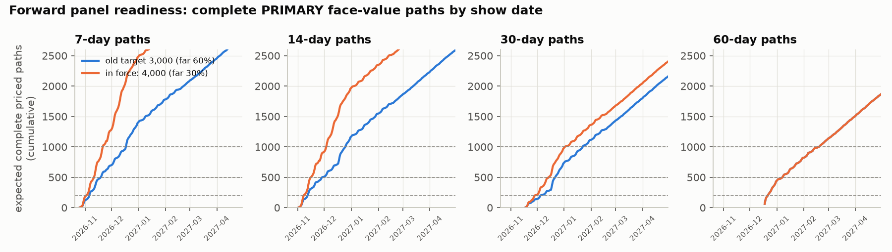

# Concert ticket price findings

What explains a concert's average ticket price (**LEVEL**), and how do prices move in the weeks before a show (**PATH**)? This is the final report. Every finding is cited by the tag the skeptic approved ([L1]–[L23], [P1]–[P5]); the detail behind each one is in `reports/level_findings.md` and `reports/path_findings.md`.

**How to read the numbers.** Effects are percent differences in average ticket price (Sep-2026 dollars), with a 95% confidence interval (CI) in brackets. *q* is the p-value after the Benjamini–Hochberg correction over a family of 16 hypotheses fixed in advance; q < 0.05 counts as supported. "Within tour" means we compare nights of the same tour, so the artist and tour are held fixed.

## Data inventory

| source | what we have | used for |
|---|---|---|
| Wikipedia tour articles (Billboard Boxscore / Pollstar figures) | 71,285 shows; 24,078 with a price; **analysis sample 23,323 shows, 304 artists** | LEVEL outcome: average ticket price per show |
| Wikidata | venue capacity, type and coordinates; artist genre and career start. Venue fields filled for 96.4% of the sample | venue size, indoor/outdoor, genre, career |
| Wikimedia Pageviews | daily artist attention | popularity and momentum (explanatory only) |
| MusicBrainz | artist identity, type, country, career start; genre tags (supplementary) | artist keys, genre fallback |
| ListenBrainz | 2026 listener snapshot | popularity feature in the prediction model |
| Open-Meteo | show-day weather, filled for 98.2% of the sample | rain at outdoor shows |
| US Census ACS, BLS CPI-U | metro income and population; inflation deflator | metro effects; real prices |
| Federal Reserve, ECB | exchange rates | checking that "$" figures aren't foreign currency |
| Ticketmaster Discovery API | forward panel since 2026-10-19: 8,981 daily snapshots of 3,025 events in the first 3 days; watchlist now 4,000 events | PATH: **primary face-value** ranges only, not resale |

The sample covers 58% of played shows in documented tours, and coverage is higher for big metros and big venues and falls later in a tour. All results describe big, Boxscore-reporting tours. Currency checks found no foreign-currency contamination of "$" figures.

Resale price histories, the core PATH data, are **not** in hand: every resale marketplace prohibits automated access, so they wait on the permission requests in Next steps.

Licenses and attribution are in [DATA_LICENSES.md](../DATA_LICENSES.md). Ticketmaster snapshots are not redistributed; only aggregates appear here. "Data from Ticketmaster Discovery API."

## Confirmed patterns

These survive the multiple-testing correction and hold across the sensitivity checks (US only, 2016+, selection-weighted, well-covered tours, and others).

- **Where a show is played matters a lot [L1].** For the same artist in the same year, metro premiums have a spread (SD) of 10.8 log points (p = 0.001, q = 0.008); 7.9 within the US alone. 65 of 146 metros differ from the reference. Priciest: Singapore +64%, Tokyo +34%, Las Vegas +33%. Cheapest: Warsaw −25%, Lisbon −21%. Las Vegas likely reflects residency and casino pricing, not the city alone.
- **Bigger US metros pay more [L3]:** +2.9% per 1 SD of metro population [+0.9, +5.1], q = 0.022, with income held fixed. This is the total association: big metros also get bigger venues and more nights.
- **Multi-night stands price higher [L7]:** +5.3% [+3.8, +6.8], q < 0.001. Extra nights are added *because* demand is strong, so this is demand showing itself, not an effect of adding nights.
- **Reunion tours price higher [L17]:** +25.0% [+12.9, +38.4], q = 0.008, carried by 10 artists (The Police, Genesis, Spice Girls, RBD and others). With artist-specific price trends it shrinks to +18.4% [+2.8, +36.4]. A placebo that flags each other artist's last tour finds nothing (+0.2%). This is an association with reunion-labelled tours, not the effect of reuniting.

## Surprising findings

- **Primary face prices almost never move [P1].** On Ticketmaster, only 17 of 3,596 priced event-days changed min or max face value in the first 3 days: 0.47% (95% CI 0.3–0.76%). When they did move, it was a step (median 23.4% for the minimum), not a drift.
- **Genre matters far less than it looks [L20, L23].** Raw, country shows are 25.7% cheaper than pop [−37.4, −11.8], the only genre contrast clearly different from pop. But once the prediction model knows the artist's scale and career, genre's effect spans only a few percent.
- **The "fanbase vs. venue" ratio is really about the venue [L11].** The ratio of pageviews to tickets per show associates with +9.6% per 1 SD, but splitting it shows pageviews add nothing within artist (+0.015, SE 0.030); the capacity side (−0.094, SE 0.028) carries it.
- **Wikipedia attention doesn't track price within an artist [L18, L19].** Neither the level of pageviews (−0.8% per 1 SD, q = 0.948) nor short-run momentum (+0.1%, q = 0.948) moves price. Most of this attention comes after the on-sale, when prices are already set, so this doesn't rule out momentum affecting the original pricing decision.
- **The model can rank nights within a tour, a little [L22].** Predicting which nights of an unseen artist's tour price above the tour median beats guessing the median: test MAE 0.152 vs 0.171 (difference −0.019 [−0.026, −0.009]).

## Hypotheses that didn't matter

| hypothesis | effect [95% CI] | q |
|---|---|---|
| Weekend (Fri/Sat vs Mon–Thu), within tour [L4] | +1.2% [+0.2, +2.3] | 0.052 |
| Holiday eve / long weekend [L5] | +1.2% [−0.2, +2.7] | 0.165 |
| Metro income, US [L2] | +0.6% per 1 SD [−0.7, +2.0] | 0.444 |
| Later tour leg [L6] | −0.1% [−2.8, +2.7] | 0.948 |
| Venue size, Wikidata capacity [L9] | −1.5% per 1 SD [−3.2, +0.1] | 0.165 |
| Outdoor venue [L10] | −1.3% [−4.7, +2.3] | 0.584 |
| Number of openers [L12] | −1.7% per 1 SD [−4.1, +0.8] | 0.300 |
| Co-headline package vs solo [L13] | +8.2% [−6.0, +24.6] | 0.439 |
| Opener draw (opener pageviews) [L14] | +2.0% per 1 SD [+0.2, +3.7] | 0.072 |
| Rain at an outdoor show [L15] | −1.3% [−3.3, +0.8] | 0.354 |
| Artist popularity / momentum [L18, L19] | −0.8% / +0.1% per 1 SD | 0.948 / 0.948 |

**Weekend is borderline, not absent [L4].** It misses the cut at q = 0.052, but it is small and positive in every check (+1.2% to +2.0%; US only +1.8%, p = 0.001). The best reading is a 1–2% weekend premium right at the edge of what this data can detect (minimum detectable effect ≈ 1.3%).

Outside the tested family, as descriptive results: farewell tours −3.4% [−13.1, +7.5] with only 7 artists carrying the contrast [L16]; tickets per show −2.8% per 1 SD, an association only, since capacity is set in response to demand [L8].

## LEVEL prediction error

**What this is [L21]:** a cross-sectional benchmark for an artist with no price history, described by 2026 snapshot features (ListenBrainz listeners, Wikidata genre and career data, today's venue capacity) that postdate most past shows. **It is not a forecast made at on-sale time.**

On held-out artists (test split: 4,336 shows, 58 artists, touched once), a gradient-boosted model is off by a mean of **0.275 log points, about $34 per ticket (median $24)**. The best simple baseline, the year median, is off by 0.347 ($42.6). The model's gain is −0.073 log points [−0.115, −0.043].

| model (test split) | MAE (log) | MAE ($) | median error ($) |
|---|---|---|---|
| reference: artist's own past median (not available for a new artist) | 0.226 | 28.5 | 18.0 |
| GBM | 0.275 | 34.1 | 24.1 |
| year median | 0.347 | 42.6 | 30.8 |
| genre × 5-yr median | 0.357 | 43.6 | 32.4 |
| global median | 0.371 | 45.0 | 33.6 |

Part of the accuracy rests on snapshot information: on the validation split, removing the ListenBrainz snapshot costs about 0.01 log points of MAE, and removing career variables too costs about 0.03. The model leans most on year, years active, ListenBrainz listens and capacity [L23]. These are associations the model uses, not effects; the year × ListenBrainz interactions are an artifact of a 2026 listener count describing recent shows better than old ones.

## PATH: what we can and can't say

**What we have [P1].** Ticketmaster PRIMARY face value moved on only ~0.47% of priced event-days in the first 3 days (17 of 3,596; CI 0.3–0.76%). No event changed its number of price levels. Differences by days to show or genre are all within noise, with single-digit move counts per cell. This is a baseline, not evidence for any hypothesis, and 67.9% of these pairs are 30 or more days out, so it says little yet about the final weeks.

**What we can't say.** Every price here is primary face value without fees. The resale questions (do prices fall late, rise for sell-outs, peak 9–10 days out, bottom out in the final hours?) **need StubHub/Rebrowser resale data**; the forward panel cannot answer them. Path-shape clustering isn't possible yet: there are no complete paths of any length [P5].

**Readiness schedule [P2, P3].** The watchlist was raised to 4,000 events with 30% of new slots far out (scenario C, in force from 2026-10-22), quota-safe at a worst day of 4,370 calls against a 4,500 budget. Expected first date with N complete *priced* paths:

| path length | N ≥ 200 | N ≥ 500 | N ≥ 1,000 |
|---|---|---|---|
| 7 days | 2026-11-03 | 2026-11-12 | 2026-11-22 |
| 14 days | 2026-11-08 | 2026-11-16 | 2026-12-04 |
| 30 days | 2026-11-29 | 2026-12-15 | **2027-01-02** |
| 60 days | 2026-12-22 | 2027-01-08 | 2027-02-19 |

The 60-day horizon is set by the calendar, not the watchlist size: priced N ≥ 1,000 arrives on 2027-02-19 in every scenario.

**Pre-registered tests [P2].** The family is fixed before any estimate exists: **{H20a, H9p}**.

- **H20a:** primary face repricing becomes more frequent as the show approaches (0–6 days vs 21–29 days).
- **H9p:** events with wide primary price spreads (max/min ≥ 3, a proxy for platinum or tiered pricing) reprice more often.

Both run **once**, on pairs not yet observed, when the panel reaches **≥ 1,000 complete priced 30-day paths (~2027-01-02)**. The date moved from 500 to 1,000 paths because H9p is underpowered at 500. The spec is frozen by hash and the test code refuses a second run. H37 (repricing at sale-phase dates) left the family as underpowered even at 1,000 and is reported descriptively; H20b is descriptive because its threshold was set after the base rate was seen.

**Literature [P4].** The main predictors of path shape in the literature are remaining inventory relative to time (sell-out status) and the timing mix of late buyers. Both need resale data.

## Next steps

**1. Submit the Rebrowser StubHub research request first** (REBROWSER_REQUEST.md). A resale forecast depends on it: its StubHub listings run from 2024-03-31 with all-in price, section, quantity and first/last-seen dates, which is the only ready-made route to resale paths 60 days out. The request must ask for the premium price fields by name (`price`, `faceValue`, `minPrice`, `ticketsRemaining`), since the public sample has every price masked and no event observed on two days. **Provenance caveat to disclose:** Rebrowser collects this data with automated browsers from marketplaces whose terms restrict automated access; the user accepted this risk (DECISIONS.md item 3), using Rebrowser's own channels only.

**2. Then Rebrowser Gametime** (final hours and days of the path) **and SeatGeek events only** (a second resale path, plus `ticketmasterId` cross-IDs to join with our Ticketmaster panel).

**3. Then the direct asks in PERMISSION_REQUESTS.md**, in its ranked order: StubHub (#1, the clean route to the same data), TicketData.com (#2, daily get-in price histories), SeatGeek API (#3), and Pollstar (#4, the highest-value addition for LEVEL). The optional Ticketmaster storage clarification (#0) covers keeping the daily panel for months. Nothing has been sent yet.

**4. Keep the Mac awake around 09:15 every day.** The daily collector runs then, and a missed whole day is lost for good. One such day in November would end about 174.2 in-progress 7-day paths (113.7 priced). A run that starts more than about 3 h late can also truncate the next day's run under the rolling 24 h quota.

### Limitations

- **Snapshot features in the prediction benchmark [L21].** ListenBrainz listeners, genre labels and venue capacity are 2026 snapshots applied to shows going back decades, so the held-out error is a cross-sectional benchmark, not on-sale forecasting skill.
- **53 `link_ambiguous` shows kept in the frozen model.** 53 priced shows (0.2%) whose venue coordinates are more than 50 km from the city were left in the frozen LEVEL model rather than refit.
- **MusicBrainz genre columns are CC BY-NC-SA 3.0.** `mb_genre_tags`, `mb_genre_coarse` and `genre_coarse_final` keep any reuse of `data/shows.parquet` non-commercial and share-alike; dropping them and rebuilding genre from Wikidata removes the restriction.
- **Capacity is mostly a sports configuration.** Wikidata capacity is today's figure, often for a sports layout, so it measures the room, not that night's concert setup [L9]. The better-measured tickets per show is itself an outcome of demand [L8].
- **Selection and scope.** 58% coverage of played shows, tilted toward big metros and early tour dates, and only big Boxscore tours. The forward panel is tilted toward genres where Ticketmaster publishes price ranges.
