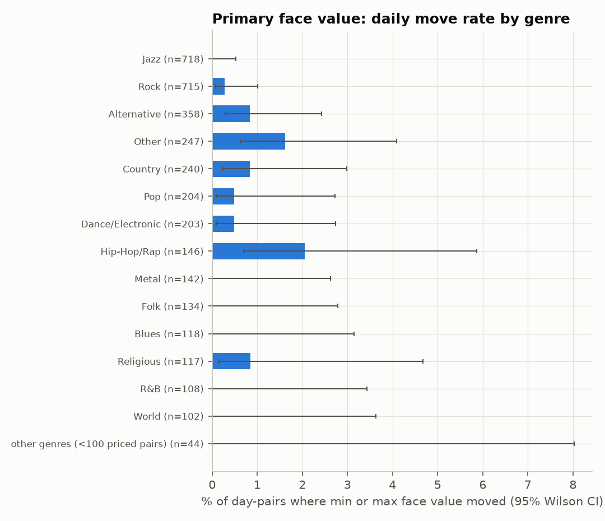

# PATH findings (task 8): what the forward panel shows now, and when it will be ready

Generated by `src/analysis/path_report.py --all` (runs `path_panel.py`, `path_tm_moves.py`, `path_readiness.py`, `path_hypotheses.py`). Every number below comes from `reports/path_tables/`. The forward panel (`data/forward/tm_forward.sqlite`) is opened read-only, and only aggregates are written (Ticketmaster storage terms, FORWARD_COLLECTOR.md §6). "Data from Ticketmaster Discovery API."

> **All prices in this report are PRIMARY-market face values** (Ticketmaster `priceRanges`: standard / USD, without fees). **They are not resale prices.** No resale PATH hypothesis (late decline, late rise for sell-outs, a T-9/10 peak, final-hours minimum) can be tested from this panel. Those still wait on the Rebrowser grant or the marketplace permissions.

## Summary

- **[P1] In the panel's first 3 snapshot days, primary face value rarely moved day to day** (2 day-to-day transitions; 97.8% of priced pairs are ranges-pool events and 67.9% are ≥ 30 days out, so this says little about the last weeks before a show). 17 of 3,596 priced event-day pairs changed min or max face value: 0.47% (Wilson 95% CI 0.3–0.76%). No event changed its number of price levels (0 changes). When a change happened it was a step (median |Δ| 23.4% for min, 19.7% for max). That is consistent with H20 (tier releases, not drift), but this is descriptive: 2 day-to-day transitions are far too short to test anything.
- **[P2] Readiness** (scenario C, in force from 2026-10-22). N ≥ 200 complete priced paths arrive by 2026-11-03 (7-day), 2026-11-08 (14-day), 2026-11-29 (30-day) and 2026-12-22 (60-day). N ≥ 1,000 arrives by 2026-11-22, 2026-12-04, 2027-01-02 and 2027-02-19. The full table, with the old 3,000 target for comparison, is in P2.
- **[P3] Watchlist raised to 4,000 events, far share 30% (scenario C): implemented by collector-path and chosen by the lead.** It is quota-safe: worst day 4,370 calls against the 4,500 rolling-24 h budget. Priced N ≥ 1,000 moves from 2026-12-18 to 2026-11-22 for 7-day paths, from 2026-12-26 to 2026-12-04 for 14-day paths, and from 2027-01-23 to 2027-01-02 for 30-day paths. 60-day dates are unchanged. The trade-off: the 60-day IPW effective sample size is 275.5, against 445.0 had the far share stayed at 60% (status quo 254.4).
- **[P4] Literature.** LITERATURE.md §C adds 7 sources and a table of what predicts path shape. Remaining inventory relative to time and the timing mix of late buyers are the main moderators, and both need resale data.
- **[P5] No clustering of path shapes yet.** The panel has 3 snapshot days and no complete path of any horizon. What the collector still needs is listed in P5.

## [P1] What the forward panel shows today (PRIMARY face value)

Panel: 8,981 HTTP-200 snapshots of 3,025 events on 2026-10-19, 2026-10-20, 2026-10-21 (UTC run days). 6,312 snapshots carry `priceRanges`; 887 of those are **$0.00 placeholder ranges**, which are treated as missing, so a $0 → price step counts as a range appearing, not as repricing. A day-pair is the same event on two consecutive days. There are 5,956 day-pairs, 3,596 of them priced on both days. A *move* is a change of more than half a cent in the min or max face value.

- **Move rate:** 17 moves in 3,596 priced day-pairs = **0.47%** (Wilson 95% CI 0.3–0.76%). By event: 17 of 1,806 events with ≥ 2 priced consecutive days moved at least once (0.94%, CI 0.59–1.5%). The Wilson CI treats pairs as independent; that is harmless here because no event moved more than 1 time. The median move was 17 days before the show.
- **Pair count reconciled:** an earlier draft said 3,602 priced pairs. That count kept snapshots taken after the show had started; the panel excludes them (snapshot time ≥ show start, `path_panel.py`), which removes 6 pairs and leaves 3,596, the number the skeptic recomputed. Every rate here uses the panel definition.
- **Direction and size:** 8 pairs had an upward change and 10 a downward change (a pair can have both). Among moves, the median |Δmin| is 23.4% and the median |Δmax| is 19.7%. These are steps, not small drifts.
- **Price levels:** the number of ranges per event never changed (0). Every range is `standard` USD without fees, so no fee-inclusive type appeared and fee dynamics are invisible here.
- **Ranges appearing or disappearing:** 4 appeared out of 2,354 unpriced-before pairs, and 6 disappeared. In the random no-ranges draw, no range appeared yet (0 of 1,464 pairs). That is the promotion and IPW question, and it needs weeks to answer.
- **Status changes:** 27 day-pairs changed `event_status`. Onsale ↔ offsale flips dominate (table below). Offsale is not a sell-out flag: the Discovery API has no sell-through, so "fill" below means the selection pool (events chosen because they publish ranges vs. the random no-ranges draw).

**By days to show** (later snapshot of the pair). See also `charts/path_tm_moves_by_daysout.png`.

| days to show | day-pairs | priced pairs | moves | move % | CI lo % | CI hi % | ranges appeared | status changes |
|---|---|---|---|---|---|---|---|---|
| 0-6 | 547 | 314 | 5 | 1.59 | 0.68 | 3.67 | 2 | 5 |
| 7-13 | 375 | 244 | 2 | 0.82 | 0.23 | 2.94 | 0 | 2 |
| 14-29 | 920 | 596 | 3 | 0.5 | 0.17 | 1.47 | 1 | 1 |
| 30-59 | 1085 | 671 | 6 | 0.89 | 0.41 | 1.94 | 0 | 2 |
| 60-89 | 1710 | 1088 | 0 | 0.0 | 0.0 | 0.35 | 0 | 7 |
| 90+ | 1319 | 683 | 1 | 0.15 | 0.03 | 0.82 | 1 | 10 |

**By genre** (genres with ≥ 100 priced pairs). See also `charts/path_tm_moves_by_genre.png`.

| genre | priced pairs | moves | move % | CI lo % | CI hi % |
|---|---|---|---|---|---|
| Jazz | 718 | 0 | 0.0 | 0.0 | 0.53 |
| Rock | 715 | 2 | 0.28 | 0.08 | 1.01 |
| Alternative | 358 | 3 | 0.84 | 0.29 | 2.43 |
| Other | 247 | 4 | 1.62 | 0.63 | 4.09 |
| Country | 240 | 2 | 0.83 | 0.23 | 2.99 |
| Pop | 204 | 1 | 0.49 | 0.09 | 2.72 |
| Dance/Electronic | 203 | 1 | 0.49 | 0.09 | 2.74 |
| Hip-Hop/Rap | 146 | 3 | 2.05 | 0.7 | 5.87 |
| Metal | 142 | 0 | 0.0 | 0.0 | 2.63 |
| Folk | 134 | 0 | 0.0 | 0.0 | 2.79 |
| Blues | 118 | 0 | 0.0 | 0.0 | 3.15 |
| Religious | 117 | 1 | 0.85 | 0.15 | 4.68 |
| R&B | 108 | 0 | 0.0 | 0.0 | 3.43 |
| World | 102 | 0 | 0.0 | 0.0 | 3.63 |
| other genres (<100 priced pairs) | 44 | 0 | 0.0 | 0.0 | 8.03 |

**By selection pool ("fill")**

| pool | day-pairs | priced pairs | moves | move % | ranges appeared | status changes |
|---|---|---|---|---|---|---|
| ranges pool | 4103 | 3516 | 16 | 0.46 | 4 | 22 |
| random no-ranges draw | 1464 | 0 | 0 |  | 0 | 3 |
| pilot (unweighted) | 389 | 80 | 1 | 1.25 | 0 | 2 |

**Status transitions**

| from | to | day-pairs |
|---|---|---|
| offsale | onsale | 18 |
| onsale | cancelled | 6 |
| onsale | offsale | 2 |
| onsale | rescheduled | 1 |

Reading: none of the bucket or genre differences can be distinguished. Every CI overlaps, and the counts of moves per cell are single digits. These tables are a baseline for the pre-registered tests (H20a/H20b/H9p/H37 below), not evidence for them.

## [P2] Data-readiness schedule

A **complete h-day path** has daily snapshots from h days before the show through show day. The event must be first snapshotted ≥ h days out, with at most ⌊0.1·(h+1)⌋ missing days, which allows 0, 1, 3 and 6 misses for h = 7, 14, 30 and 60. A path counts as **priced** if it also has a valid range (min > 0): for events already watched, the latest snapshot; for future additions, the candidate's flag discounted by the observed 0.141 share of $0 placeholders. Counts are **expected values**: each event contributes P(complete), with days already missed counted exactly and future days missing at the observed per-event rate of 0.0015.

Future additions are simulated with the collector's own selection code (`forward_collector.select_panel`, option (b)) day by day from 2026-10-22, topping the watchlist up to its target from the 21,302 known candidates. New day-120 slices are added at the observed rate of 74.5 events per day, resampled from the 90–120-day mix of the first full scan (0.189 with ranges). Without these arrivals (rows A0/B0 in `readiness_schedule.csv`) the 7- to 30-day dates hardly change, but N ≥ 1,000 priced 60-day paths is never reached by 2027-06-30. The far band's priced pool was exhausted on day 1, so the 60-day horizon depends on new far events publishing ranges.

**First date by which N complete paths exist.** The status quo is the old target of 3,000 with a 60% far share. **The 4,000 / far 30% columns (scenario C) are the configuration in force from 2026-10-22.**

| horizon (days) | N | status quo: all | status quo: priced | 4,000 far 60%: all | 4,000 far 60%: priced | C, in force: all | C, in force: priced |
|---|---|---|---|---|---|---|---|
| 7 | 200 | 2026-11-02 | 2026-11-06 | 2026-10-31 | 2026-11-04 | 2026-10-31 | 2026-11-03 |
| 7 | 500 | 2026-11-12 | 2026-11-19 | 2026-11-07 | 2026-11-13 | 2026-11-06 | 2026-11-12 |
| 7 | 1000 | 2026-11-28 | 2026-12-18 | 2026-11-20 | 2026-12-04 | 2026-11-14 | 2026-11-22 |
| 14 | 200 | 2026-11-07 | 2026-11-13 | 2026-11-07 | 2026-11-10 | 2026-11-06 | 2026-11-08 |
| 14 | 500 | 2026-11-18 | 2026-11-29 | 2026-11-14 | 2026-11-21 | 2026-11-13 | 2026-11-16 |
| 14 | 1000 | 2026-12-11 | 2026-12-26 | 2026-11-29 | 2026-12-18 | 2026-11-21 | 2026-12-04 |
| 30 | 200 | 2026-11-29 | 2026-12-05 | 2026-11-27 | 2026-12-03 | 2026-11-27 | 2026-11-29 |
| 30 | 500 | 2026-12-18 | 2026-12-22 | 2026-12-11 | 2026-12-19 | 2026-12-06 | 2026-12-15 |
| 30 | 1000 | 2026-12-27 | 2027-01-23 | 2026-12-23 | 2027-01-15 | 2026-12-19 | 2027-01-02 |
| 60 | 200 | 2026-12-19 | 2026-12-22 | 2026-12-19 | 2026-12-22 | 2026-12-19 | 2026-12-22 |
| 60 | 500 | 2026-12-27 | 2027-01-08 | 2026-12-26 | 2027-01-08 | 2026-12-26 | 2027-01-08 |
| 60 | 1000 | 2027-01-16 | 2027-02-19 | 2027-01-08 | 2027-02-19 | 2027-01-14 | 2027-02-19 |

- **Short horizons arrive well before 2026-12-18**, as expected. Under C, priced N ≥ 200 is reached on 2026-11-03 (7-day) and 2026-11-08 (14-day), and N ≥ 500 on 2026-11-12 and 2026-11-16 (old target: 2026-11-19 and 2026-11-29).
- **The 60-day horizon is set by the calendar, not by slots.** The first complete 60-day paths can only finish 60 days after collection began, and priced N ≥ 1,000 arrives on 2027-02-19 in every scenario.
- **Whole-day outages are the main risk for short horizons.** The per-event miss rate excludes days the Mac is off all day. One such day in November would end about 174.2 in-progress 7-day paths (113.7 priced; current watchlist, average over November days). A 14-day path tolerates one such day, and 30- and 60-day paths tolerate three and six. On 2026-10-20 the scheduled run was cut by the quota, and a second run the same day took the missing snapshots.

## [P3] Watchlist expansion: quota math, effect on dates and IPW

Quota (all values from `readiness_summary.json`; budget 4,500 calls per 24 h, Ticketmaster quota 5,000):

| target | worst day (calls) | headroom | est. run time (min, observed rate) | 2nd run <24 h later: calls available |
|---|---|---|---|---|
| 3,000 | 3,340 | 1,160 | 93 | 1,410 |
| 4,000 | 4,370 | 130 | 121 | 380 |

- Worst day = target × (1 + 3.0% retry/error margin; observed max 1.25%) + 250 reserved for the weekly full discover rescan (observed 212 calls, pilot included). The largest safe target is 4,126. 4,000 leaves 130 calls of headroom, and Ticketmaster's Rate-Limit-Available stays above the collector's 250-call stop.
- **The quota is a rolling 24 h window** (collector-path found this on 2026-10-21: on 2026-10-20 the quota ran low after 1,563 calls because the previous run still counted). With one run per day this is fine. If a catch-up run (Mac asleep at 09:15) lands less than 24 h before the next scheduled run, the second run has only 380 calls until the first run's calls age out. It waits up to 3 h, then stops. Snapshots go nearest show first, so the far events lose that day; a 60-day path tolerates six such misses.
- Run time uses the observed throughput of the largest daily run (36.0 calls/min; the run is latency-bound, well under the 3 req/s cap), so a 4,000-event day takes about two hours.
- **What changed in selection:** only the target (4,000) and the far share (30% of new slots, was 60%). Option (b), the 80% ranges pool and per-pick `selection_prob` are unchanged. The first top-up is the 2026-10-22 daily run (simulated: about 1,023 events that day). Day-0 snapshots that don't fit under the cap that day start on 2026-10-23, so a few simulated paths may start one day later than modeled. FORWARD_COLLECTOR.md documents the change, the drift risk (a run more than about 3 h late truncates the next one), and the IPW rule below.

**Effect on IPW** (Kish effective sample size of 1/selection_prob weights among expected complete paths by the milestone date; pilot events carry no weights and are excluded):

| scenario | paths by | expected paths | Kish ESS | weight CV |
|---|---|---|---|---|
| status quo 3,000 | h7_by_2026-11-30 | 915.9 | 108.9 | 2.742 |
| status quo 3,000 | h14_by_2026-12-18 | 1,146.7 | 152.6 | 2.554 |
| status quo 3,000 | h30_by_2027-01-15 | 1,488.0 | 142.2 | 3.077 |
| status quo 3,000 | h60_by_2027-02-16 | 1,890.0 | 254.4 | 2.537 |
| 4,000 far 60% | h7_by_2026-11-30 | 1,243.9 | 187.6 | 2.391 |
| 4,000 far 60% | h14_by_2026-12-18 | 1,513.6 | 242.4 | 2.291 |
| 4,000 far 60% | h30_by_2027-01-15 | 1,872.0 | 184.0 | 3.029 |
| 4,000 far 60% | h60_by_2027-02-16 | 2,560.0 | 445.0 | 2.18 |
| 4,000 far 30% | h7_by_2026-11-30 | 1,736.0 | 280.7 | 2.294 |
| 4,000 far 30% | h14_by_2026-12-18 | 2,283.5 | 395.6 | 2.185 |
| 4,000 far 30% | h30_by_2027-01-15 | 2,002.0 | 273.7 | 2.513 |
| 4,000 far 30% | h60_by_2027-02-16 | 2,100.0 | 275.5 | 2.574 |

Weights are very uneven (CV above 2): the random no-ranges draw has small selection probabilities and large weights. Both expansions lower the CV. The 30% far share (C, implemented) gives the largest ESS at 7 to 30 days but gives back most of the 60-day gain that a 60% far share would have had. **Caveat on these ESS figures:** they pool all selection days. `selection_prob` is the share within that day's pool, and the band mix changed between cohorts (60% far on 2026-10-19, 30% from 2026-10-22). So the analysis must treat the selection day as an extra stratum and combine cohort-stratified estimates (FORWARD_COLLECTOR.md). Pooled ESS is a rough guide to relative precision only. **Caveat for the ranges pool:** there, `selection_prob` is the realized share of a deliberate, diversity-capped pick, not a sampling probability. IPW therefore reweights toward the candidate pool's band mix and cannot support statements about all US events; the registered IPW sensitivity carries the same caveat (below).

## [P4] Literature on PATH (LITERATURE.md §C)

New verified sources: Gallego & van Ryzin (1994), Board & Skrzypacz (2016), Williams (2022), Xu, Fader & Veeraraghavan (2019), Diehl, Maxcy & Drayer (2015), Waisman (2017 seminar abstract) and Kemper & Breuer (2016), each with a verification marker. **2 of these 7 have unverified findings:** Waisman (only seminar abstracts seen; venue and findings UNVERIFIED) and Kemper & Breuer (abstract only; efficiency conclusion UNVERIFIED). Waisman was listed twice (items 9 and 31); the entries are merged into item 9. On top of the existing Sweeting (2012), Leslie & Sorensen (2014), Courty (2003), Bhave & Budish (2023) and CMA (2025) entries, the literature names these predictors of path shape: **remaining inventory relative to time** (sell-out status), **the timing mix of buyers** (late high-value demand), **seller type**, **seat tier**, **the primary pricing regime** and **late demand news**. All but the primary regime need resale data. Two new hypotheses: H36 (resale paths differ by seat tier; excluded until resale data exist) and H37 (primary face changes cluster at scheduled sale-phase dates; descriptive only, see below).

## [P5] Path-shape clustering: not supported yet

Clustering needs complete paths, and none exist: 3 snapshot days, 3,025 events, 8,981 panel rows. Clustering would also be nearly empty of signal on primary face values, which moved on 0.47% of priced day-pairs. What the collector still needs:

1. **≥ 500 complete priced 30-day paths** (expected 2026-12-15 under C; 2026-12-22 under the old target) for primary-path summaries, and ≥ 1,000 (2027-01-02) for moderator splits.
2. **Daily continuity.** Whole-day outages break short paths (P2), so the Mac must be awake at 09:15 or the job must catch up the same day.
3. **Resale data for resale shapes.** Shapes like a late decline, a late rise or a mid-path peak are resale phenomena. Primary face paths will mostly be flat with occasional steps, so the useful primary features are step count, step timing relative to sale phases (H37) and range spread.
4. **A registered design before any fit:** shape features (normalized path on a 0–60-day grid, number and timing of steps, net change), k chosen by silhouette on the training artists, and a split time-ordered and grouped by artist. These go into `path_spec.json` (currently no features and no split, because no model is fitted and no out-of-sample claim is made). <!-- notrace: design constants -->

## Pre-registered PATH hypotheses (BH family, declared 2026-10-21)

The family is fixed now, before any estimate exists, and was revised the same day after skeptic review 4 (F1–F6), still before any estimate. It is {H20a, H9p}. Every member is **pending** and enters BH at p = 1 until its test date. Sample: events with a complete priced 30-day path (snapshots from 30 days before the show's local date through show day, a valid range on the first path day, at most 3 of 31 days missing). Unit: event-day pairs (consecutive days, both priced) whose later snapshot is 0-29 days before the show and AFTER 2026-10-21: every pair observed up to the registration date is excluded, so all tests run on unseen pairs. move = |change| > $0.005 in min or max face value. Weights: none in base. SE clustered by artist (first attraction id); p and 95% CI from t(G - 1); null-imposed wild cluster bootstrap (Webb, 1,999 draws) and leave-one-artist-out range if G < 30. <!-- notrace: design constants (thresholds, draws, cluster rule) -->

IPW sensitivities: 'IPW (selection)' pools all selection days with weights 1/selection_prob; 'IPW (selection-day strata)' estimates within each selection day (the cohorts have different far shares: 60% on 2026-10-19, 30% from 2026-10-22; strata under 50 events merge into the previous day) and combines the estimates by each stratum's weight total. Pilot events have no selection_prob and drop out of both. Caveat: for the ranges pool, selection_prob is the realized share of a deliberate, diversity-capped pick, not a sampling probability, so IPW reweights toward the candidate pool's band mix and supports no statement about all US events. <!-- notrace: pre-registration text -->

| hid | claim | test | status |
|---|---|---|---|
| H20a | Primary face-value repricing becomes more frequent as the show approaches. | LPM: move ~ 1[0-6 days] + 1[7-13] + 1[14-20] (reference 21-29 days) + event FE + day-of-week dummies (later snapshot), no date FE (F3: date FE + event FE would make days to show collinear). One-sided test that the 0-6-day coefficient > 0. | pending (p = 1, q = 1) |
| H9p | Events with wide primary price spreads (max/min >= 3 on the path's first day, a proxy for platinum/tiered pricing) reprice more often. | LPM: move ~ wide_spread + days-to-show bucket dummies + day-of-week dummies; two-sided test on wide_spread. wide_spread is measured as of the first path day (no look-ahead). | pending (p = 1, q = 1) | <!-- notrace: pre-registration text -->

Test date for every member: first daily run on or after the date the panel reaches N >= 1,000 complete priced 30-day paths (readiness_schedule.csv, scenario C, expected 2027-01-02; moved from N >= 500 before any data because H9p is underpowered at 500, power.json), run once. Disclosure: declared after the 3-day descriptive move rates were computed; no estimate of any member existed.

**Excluded with reasons.** Resale-price hypotheses (the panel is PRIMARY face value; they need the Rebrowser StubHub/Gametime data or marketplace permissions): H1, H2, H3, H4, H5, H7, H10, H11, H12, H13, H14, H17, H21, H35, H36. Others: H9r: resale half of H9 (resale premium/path flatness): resale-price hypothesis: the forward panel is PRIMARY face value; needs Rebrowser StubHub/Gametime or marketplace data; H18: needs listing-format (auction vs fixed) data, which no approved source has; H20b: descriptive only (review 4 F1): threshold set after the rate was seen; H32p: PATH half of H32 (state resale caps): resale-price hypothesis: the forward panel is PRIMARY face value; needs Rebrowser StubHub/Gametime or marketplace data; H37: descriptive only: underpowered at N = 1,000 under the registered power rule (power.json). The full reasons are in `bh_family.json`.

**Power (F4), registered before any test** (`path_power.py`, `power.json`, `path_spec.json`): simulated, artist-clustered minimum detectable effects on the daily move probability, 80% power at α = 0.05/3, from the observed base rate 0.47%. The rule: a test is underpowered if its MDE exceeds 1 pp; the run date moves to N ≥ 1,000 unless every member is powered at 500; a member still underpowered at 1,000 leaves the family and is reported descriptively. The rule's timing is self-attested: `path_power.py` was not committed before `power.json` was produced. <!-- notrace: power rule constants -->

| hid | MDE at N=500 (pp) | MDE at N=1,000 (pp) | powered at 500 | powered at 1,000 |
|---|---|---|---|---|
| H20a | 0.75 | 0.5 | True | True |
| H9p | 1.5 | 0.75 | False | True |
| H37 | 6.0 | 4.0 | False | False |

H37's exclusion does not depend on the exact limit: it is underpowered at N = 1,000 for any limit below 4.0 pp, about 8.5x the 0.47% base rate. The 1 pp limit did set the test date (H9p's MDE at N = 500 is 1.5 pp), but it moved the date later, not earlier.

Result: H9p is underpowered at N = 500, so the whole family runs once at N ≥ 1,000 complete paths. H37 is underpowered even at 1,000 (only 8.2% of events have a sale-phase date inside the 30-day window), so it left the family and is reported as an estimate without a BH p-value. H20b is descriptive (F1: its 5% threshold was set after the 0.47% rate was seen). <!-- notrace: pre-registration text -->

**Run once (F5).** The spec is frozen in `final_spec.json` (sha256 `605d8a98328b`): the sha256 of the test code (`path_hypotheses.py`), parameters, family, sample rules and MDEs. `path_hypotheses.py --final` refuses to run on a hash mismatch, before the path count is reached, or if `test_touch_log.jsonl` already holds a final touch (`tests/test_path_final_guard.py`). No test has been run, so no out-of-sample claim is made.

